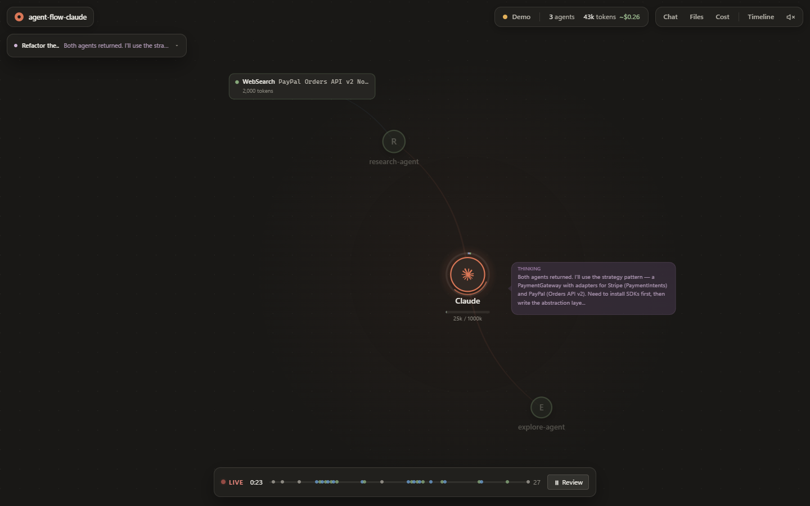

# agent-flow-claude

[](https://github.com/nguyenthanguth/agent-flow-claude/actions/workflows/ci.yml)

Real-time visualization of Claude Code sessions in your browser. Watch the main agent and its subagents think, call tools and hand results back, live, as an interactive graph.

> **Based on [Agent Flow](https://github.com/patoles/agent-flow)** by Simon Patole. This is an independent fork, not the official project and not endorsed by its maintainers. It is reduced to one job: Claude Code in the browser.



## What's different from Agent Flow

| | Agent Flow | agent-flow-claude |
|---|---|---|
| Runs as | VS Code extension, `npx` app, dev server | One local server + browser UI |
| Runtimes | Claude Code and Codex | Claude Code only |
| Event source | Claude Code hooks + transcripts | Transcripts only — nothing is installed into Claude Code, `~/.claude/settings.json` is never touched |
| Subagents | Could be duplicated, never finish (Claude Code 2.1+), or vanish when the main agent ends a turn | Spawned once, streamed live, finish on time, stay on the graph (dimmed) when done |
| Telemetry | Opt-out | None |

## Features

- **Live agent graph**: the main agent, every subagent, their tool calls and messages, connected parent → child
- **Subagents in real time**, including background ones and subagents that were already running when you opened the page
- **Multiple sessions**: each active session in the project gets a tab
- **Real context and cost**: each agent's context is the actual size Claude Code reports for its latest request (not an estimate), shown as a bar and, for the main agent, a ring split by kind. Cost is the session's requests at API list prices, cache reads and writes included
- **Clear status**: Thinking, Running a tool, Waiting for you, Interrupted, Done — the main agent also shows how many subagents are still working
- **Panels**: transcript (Chat), files touched, cost estimate, timeline
- **Review mode**: pause and scrub back through the session
- **Reload-safe**: every connection replays the full history, so refreshing never loses or duplicates events

## Install

Install it once, globally, then run it from any project folder. It needs [Node.js](https://nodejs.org/) 20+, and has no runtime dependencies.

**From a release** (no clone, no build):

```bash
npm install -g https://github.com/nguyenthanguth/agent-flow-claude/releases/latest/download/agent-flow-claude.tgz
```

**From source** (to modify it, with [pnpm](https://pnpm.io/) 10):

```bash
git clone https://github.com/nguyenthanguth/agent-flow-claude.git
cd agent-flow-claude
pnpm install
pnpm install-global     # builds, then npm install -g ./server
```

The source install is a link to your clone, so after a `git pull && pnpm build` the global command is up to date. To remove it: `npm uninstall -g agent-flow-claude`.

## Usage

Go to the project you work on with Claude Code and start it:

```bash
cd /path/to/your/project
agent-flow-claude
```

Your browser opens at http://127.0.0.1:3030. Start or continue a Claude Code session in that folder (or a subfolder); it appears within about a second. Stop the server with `Ctrl+C`.

Without installing, you can run a build directly: `node server/dist/agent-flow-claude.js`. Each CI run also uploads a ready-to-run build as the `agent-flow-claude` artifact.

### Options

| Option | Description |
|---|---|
| `-w, --workspace <dir>` | Watch this project instead of the current directory (also `$AGENT_FLOW_CLAUDE_WORKSPACE`). Subfolders are included |
| `-p, --port <number>` | Server port (default `3030`). Use a different port to watch two projects at once |
| `--no-open` | Don't open the browser |
| `--verbose` | Log every event |
| `-v, --version` | Print the version |

A session is picked up if its transcript, or one of its subagents', was written in the last 10 minutes. Older sessions attach as soon as they are written to again.

## How it works

Claude Code already writes everything Agent Flow needs to disk:

```
~/.claude/projects/<encoded-project-path>/
├── <session-id>.jsonl                  main agent transcript
└── <session-id>/subagents/
    ├── agent-<id>.jsonl                one transcript per subagent
    └── agent-<id>.meta.json            { description, toolUseId, finished }
```

The server tails these files (file watchers plus a 1-second poll), turns transcript entries into agent events, and streams them to the browser over Server-Sent Events at `/events`. A subagent is named after its `description`. It finishes when its `<task-notification>` arrives or when its meta file says `finished: true`, whichever comes first.

```
server/   Node server — src/core/ (transcript + subagent parsing), src/relay.ts (session watching + SSE), src/server.ts (HTTP)
web/      React + Canvas UI, built with Vite
```

## Development

```bash
pnpm dev          # server on :3030 (auto-restart) + UI on :3000 with hot reload
pnpm dev:demo     # UI only, playing a built-in demo scenario (any build also accepts ?demo)
pnpm test         # unit tests (node:test)
pnpm typecheck    # TypeScript, server + web
pnpm build        # production build into server/dist/
```

To watch another project while developing: `AGENT_FLOW_CLAUDE_WORKSPACE=/path/to/project pnpm dev`. The dev server uses port 3030 too, so stop a running `agent-flow-claude` first.

GitHub Actions runs tests, typecheck and build on every push and pull request, and uploads the build as an artifact.

### Releasing

Bump `version` in `server/package.json`, commit, then push a matching tag:

```bash
git tag v1.0.1 && git push origin v1.0.1
```

The Release workflow tests and builds, then publishes a GitHub Release with `agent-flow-claude.tgz`, which is what the install command above downloads.

### Windows

Everything works from PowerShell, cmd or Git Bash. The repo's `.npmrc` enables pnpm's cross-platform script shell, so the POSIX-style scripts in `package.json` run under `cmd.exe` too.

## Credits and license

agent-flow-claude is derived from [Agent Flow](https://github.com/patoles/agent-flow), created by [Simon Patole](https://github.com/patoles) for [Antics](https://antics.gg). The original code and this fork are licensed under Apache 2.0; see [LICENSE](LICENSE).

"Agent Flow" and its logos are trademarks of Simon Patole ([TRADEMARK.md](TRADEMARK.md)). This fork uses the name only to describe where it comes from, and does not use the Agent Flow logo.
